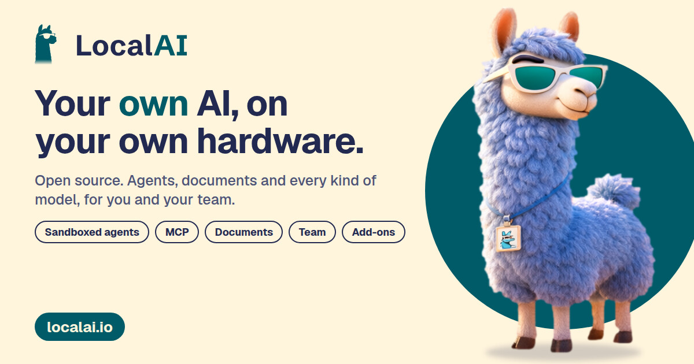

<p align="center">
  
</p>

<p align="center">
<a href="https://github.com/mudler/LocalAI/releases"></a>
<a href="LICENSE"></a>
<a href="https://discord.gg/uJAeKSAGDy"></a>
</p>

<p align="center">
<a href="https://localai.io/">Documentation</a> |
<a href="#quick-start">Quick start</a> |
<a href="https://discord.gg/uJAeKSAGDy">Discord</a> |
<a href="https://localai.io/docs/reference/faq/">FAQ</a> |
<a href="https://localai.io/blog/">Blog</a>
</p>

**LocalAI** runs open models for chat, images, speech and video on your own machines. The API speaks the OpenAI and Anthropic formats. Your team gets chats, files and documents on top, and the assistant can write and run code. It runs on a laptop, a server, in a container or on Kubernetes, and a distributed mode spreads models over several machines. No GPU needed, though a GPU makes it faster.

- **Chats, agents, Projects and a team**: chats and saved agents that use tools, [MCP](https://localai.io/docs/features/mcp/) servers, files, Knowledge collections and skills. [Projects](https://localai.io/docs/features/projects/) group chats, files, notes and agents around one piece of work. Users, roles, quotas and shared folders for a team (development builds).
- **Add-ons**: an admin installs add-ons from a library: Office, Sandbox, Tables, chat apps, mail, calendar and more.
- **Every kind of model, one API**: text, vision, speech to text, text to speech, images, video, music and sound, embeddings and reranking, in the OpenAI and Anthropic formats (with ElevenLabs-compatible text to speech and sound generation), with more than 80 backends. Each backend is its own image, pulled only when a model needs it.
- **Your hardware**: NVIDIA, AMD, Intel, Apple Silicon, Vulkan, NVIDIA Jetson or CPU only. The server, the models and your files stay on your own machines.


Created by [Ettore Di Giacinto](https://github.com/mudler) and maintained by the [LocalAI team](#team).

## Quick start

**Script** (Linux, and macOS on Apple Silicon): it downloads the release binary for your machine and checks it against the release checksums.

```bash
curl -sSL https://localai.io/install.sh | sh
local-ai
# open http://localhost:8080 and install a model from there
```

The script installs the program and does not start it; `local-ai` starts the server. To run a model directly, name it, for example `local-ai run gemma-4-e2b-it-qat-q4_0`, a small Google Gemma 4 model for CPUs (4.3 GB to download: 3.35 GB for the model and 0.99 GB for the image projector).

**Container** (Docker, podman, ...):

```bash
docker run -ti --name local-ai -p 8080:8080 localai/localai:latest
```

**Desktop app**: it installs, updates, starts and stops the server for you and shows the web interface in its own window, on macOS and Linux. It is in the 5.0 release. Download it from the [latest release](https://github.com/mudler/LocalAI/releases/latest). See the [desktop app guide](https://localai.io/docs/start/install/desktop/).

The install script and the `latest` image give 5.0.0.

Then open `http://localhost:8080`. To restart an existing container, use `docker start -i local-ai`. More ways to install: [Install LocalAI](https://localai.io/docs/start/install/).

<details>
<summary>GPU images (NVIDIA, AMD, Intel, Vulkan)</summary>

```bash
# NVIDIA, CUDA 13
docker run -ti --name local-ai -p 8080:8080 --gpus all localai/localai:latest-gpu-nvidia-cuda-13

# NVIDIA, CUDA 12
docker run -ti --name local-ai -p 8080:8080 --gpus all localai/localai:latest-gpu-nvidia-cuda-12

# NVIDIA Jetson ARM64 (CUDA 12, for AGX Orin and similar)
docker run -ti --name local-ai -p 8080:8080 --gpus all localai/localai:latest-nvidia-l4t-arm64

# NVIDIA Jetson ARM64 (CUDA 13, for DGX Spark)
docker run -ti --name local-ai -p 8080:8080 --gpus all localai/localai:latest-nvidia-l4t-arm64-cuda-13

# AMD (ROCm)
docker run -ti --name local-ai -p 8080:8080 --device=/dev/kfd --device=/dev/dri --group-add=video localai/localai:latest-gpu-hipblas

# Intel (oneAPI)
docker run -ti --name local-ai -p 8080:8080 --device=/dev/dri/card1 --device=/dev/dri/renderD128 localai/localai:latest-gpu-intel

# Vulkan
docker run -ti --name local-ai -p 8080:8080 localai/localai:latest-gpu-vulkan
```

LocalAI detects your GPU and downloads the matching backend. See [GPU Acceleration](https://localai.io/docs/models/gpu-acceleration/).

</details>

Load a model:

```bash
# From the model gallery (list it with `local-ai models list` or on the Models page of the web UI)
local-ai run gemma-4-e2b-it-qat-q4_0
# From Hugging Face
local-ai run huggingface://TheBloke/phi-2-GGUF/phi-2.Q8_0.gguf
# From the Ollama OCI registry
local-ai run ollama://gemma:2b
# From a standard OCI registry (for example Docker Hub)
local-ai run oci://localai/phi-2:latest
```

To talk to a running server from the terminal, start the built-in agent in another shell. It asks you to approve anything that changes state. See the [Terminal agent](https://localai.io/docs/features/terminal-agent/) docs.

```bash
local-ai chat --model gemma-4-e2b-it-qat-q4_0
```

More in the [Quickstart](https://localai.io/docs/start/quickstart/).

## What you can do

| Area | What it gives you |
|---|---|
| [Chats](https://localai.io/docs/features/chats/) | Conversations the server keeps, with saved agents that use tools, [MCP](https://localai.io/docs/features/mcp/), skills and files, triggers, and chat apps |
| [Add-ons](https://localai.io/docs/addons/) | Office, Sandbox, Tables, chat apps, mail, calendar and more install from a library and run beside the server |
| [Text generation](https://localai.io/docs/models/capabilities/text/text-generation/) | `llama.cpp`, `transformers`, `vllm` ... [and more](https://localai.io/docs/models/compatibility-table/), with an [OpenAI-compatible tools API](https://localai.io/docs/api/openai-functions/) and [constrained grammars](https://localai.io/docs/models/capabilities/text/constrained_grammars/) |
| Music and sound | Make music and sound effects from a text prompt with `/v1/sound-generation`. See [text to audio](https://localai.io/docs/models/capabilities/audio/text-to-audio/) |
| Speech | [Text to audio](https://localai.io/docs/models/capabilities/audio/text-to-audio/), [audio to text](https://localai.io/docs/models/capabilities/audio/audio-to-text/), voice activity detection (Silero-VAD) and the [Realtime API](https://localai.io/docs/api/openai-realtime/) for speech-to-speech |
| Images, video and vision | [Image generation](https://localai.io/docs/models/capabilities/vision/image-generation/), [video generation](https://localai.io/docs/models/capabilities/vision/video-generation/), the [Vision API](https://localai.io/docs/models/capabilities/vision/gpt-vision/) and [object detection](https://localai.io/docs/models/capabilities/vision/object-detection/) |
| Search | [Embeddings](https://localai.io/docs/models/capabilities/text/embeddings/) and a [reranker](https://localai.io/docs/models/capabilities/text/reranker/) |
| Operations | API key auth, user quotas and roles, [distributed mode](https://localai.io/docs/administration/distributed-mode/) (PostgreSQL + NATS) and [P2P inferencing](https://localai.io/docs/administration/p2p-federated-inference/) |
| Models and backends | [Models from Hugging Face](https://localai.io/docs/models/) and a [Backend Gallery](https://localai.io/docs/models/backends/) to install or remove backends on the fly, plus the integrated web UI |

LocalAI has more than 80 backends. Hardware acceleration covers NVIDIA (CUDA 12 and 13), AMD (ROCm), Intel (oneAPI/SYCL), Apple Silicon (Metal), Vulkan and NVIDIA Jetson (L4T). See the [Backend and Model Compatibility Table](https://localai.io/docs/models/compatibility-table/).

## Backends we build

Most backends wrap an upstream engine such as llama.cpp or vLLM. We wrote 18 of them ourselves: native C, C++ and GGML engines with no Python at inference.

| Backend | What it does |
|---------|-------------|
| [vllm.cpp](https://github.com/mudler/vllm.cpp) | From-scratch C++20 port of vLLM for text generation: paged KV cache, continuous batching, prefix caching, safetensors + GGUF loading, engine-enforced structured output, on CPU, CUDA, Metal and Vulkan. Also serves MiniMax-H3 joint video+audio generation |
| [parakeet.cpp](https://github.com/mudler/parakeet.cpp) | C++/GGML port of NVIDIA NeMo Parakeet ASR (tdt/ctc/rnnt/hybrid), with cache-aware streaming transcription |
| [moss-transcribe.cpp](https://github.com/localai-org/moss-transcribe.cpp) | C++/GGML port of OpenMOSS MOSS-Transcribe-Diarize: joint long-form transcription, speaker diarization and timestamping in a single pass |
| [moss-tts.cpp](https://github.com/mudler/moss-tts.cpp) | C++/GGML port of the OpenMOSS MOSS-TTS family: text-to-speech (MOSS-TTS-Local v1.5, 48 kHz stereo) with reference-audio voice cloning, through the MOSS-Audio-Tokenizer neural codec |
| [magpie-tts.cpp](https://github.com/mudler/magpie-tts.cpp) | C++/GGML port of NVIDIA's Magpie TTS Multilingual 357M: 22.05 kHz mono text-to-speech in 5 voices and 9+ languages, with the NanoCodec neural codec and tokenizer/G2P embedded in a single GGUF |
| [ced.cpp](https://github.com/localai-org/ced.cpp) | C++/GGML port of the CED audio-tagging models: sound-event classification (527-class AudioSet) over REST and the realtime API for live recognition |
| [voice-detect.cpp](https://github.com/localai-org/voice-detect.cpp) | Speaker recognition and voice analysis (ECAPA-TDNN, WeSpeaker, ERes2Net, CAM++, wav2vec2 age/gender/emotion), replacing the Python speaker-recognition backend |
| [vibevoice.cpp](https://github.com/mudler/vibevoice.cpp) | Native port of Microsoft VibeVoice for TTS (voice cloning) and long-form ASR with speaker diarization |
| [rf-detr.cpp](https://github.com/localai-org/rf-detr.cpp) | Native RF-DETR object detection and instance segmentation |
| [locate-anything.cpp](https://github.com/mudler/locate-anything.cpp) | Open-vocabulary object detection and visual grounding (LocateAnything-3B) |
| [depth-anything.cpp](https://github.com/mudler/depth-anything.cpp) | Depth Anything 3 monocular metric depth + camera pose estimation |
| [face-detect.cpp](https://github.com/mudler/face-detect.cpp) | Face detection, recognition, demographics and anti-spoofing (SCRFD/ArcFace, YuNet/SFace), replacing the Python insightface backend |
| [timestral.cpp](https://github.com/mudler/timestral.cpp) | Mistral Timestral time-series forecasting: quantile forecasts with covariates, on the CPU |
| [trellis2.cpp](https://github.com/localai-org/trellis2cpp) | C++/GGML port of Microsoft TRELLIS.2: single-image to textured 3D mesh (GLB with PBR materials) |
| [gem-x.cpp](https://github.com/localai-org/gem-x.cpp) | Live human motion capture with SOMA and SMPL pose streams (CPU/Vulkan) |
| [kimodo.cpp](https://github.com/localai-org/kimodo.cpp) | C++/GGML text-to-motion on CPU and Vulkan, exported as animated skeleton GLB |
| [privacy-filter.cpp](https://github.com/localai-org/privacy-filter.cpp) | Standalone GGML PII/NER token-classification engine powering LocalAI's PII redaction tier |
| [LocalVQE](https://github.com/localai-org/LocalVQE) | Joint acoustic echo cancellation, noise suppression, and dereverberation |

The team also ships a vector store, `local-store`, in the main tree, and maintains [apex-quant](https://github.com/localai-org/apex-quant), a per-tensor, per-layer quantization recipe for Mixture-of-Experts models that exploits their structural sparsity to produce GGUFs matching or beating Q8_0 quality. They run out of the box on stock llama.cpp.

## Latest news

<!-- Next release: add its entry here, newest first, when the release post is published: month, one line, and a link to the post. Do not add a date or a link before the post exists. -->

- **November 2026**: **LocalAI 5.0**: Projects, a desktop app for macOS and Linux, Office and Sandbox add-ons, a Files page, team sharing and Pages. [Release post](https://localai.io/blog/localai-5-0/) · [Release notes](https://github.com/mudler/LocalAI/releases/tag/v5.0.0)

- **October 2026**: **LocalAI 4.12.1**: A security fix for the policy on URLs that users give. Redirect targets are now checked on every hop. [Release notes](https://github.com/mudler/LocalAI/releases/tag/v4.12.1)
- **October 2026**: **LocalAI 4.12.0**: A redesigned web UI, streaming voice answers, decision routing with the `/v1/decisions` API, image upscaling in Studio and Qdrant stores. [Release notes](https://github.com/mudler/LocalAI/releases/tag/v4.12.0)

- **October 2026**: **LocalAI 4.11.0**: Audio scenes with transcription, speaker labels, and sound detection. Also the Decisions API (`/v1/systemone`), model failover chains, signed OCI galleries, and Kimodo text-to-animation. [Release notes](https://github.com/mudler/LocalAI/releases/tag/v4.11.0)
- **September 2026**: **LocalAI 4.10.0**: A fleet operations dashboard, one credentials file for private model sources, and `local-ai benchmark` for measuring model latency and throughput. [Release notes](https://github.com/mudler/LocalAI/releases/tag/v4.10.0)
- **August 2026**: **LocalAI 4.9.0**: Deny-by-default authentication, opt-in chat context compression, unified model and backend management, and MiniMax-H3 video generation with audio. [Release notes](https://github.com/mudler/LocalAI/releases/tag/v4.9.0)

Older news and the full release notes: [GitHub Releases](https://github.com/mudler/LocalAI/releases) and the [blog](https://localai.io/blog/).

## Resources

- [Documentation](https://localai.io/) and the [Quickstart](https://localai.io/docs/start/quickstart/)
- [LLM fine-tuning guide](https://localai.io/docs/models/training/fine-tuning/), [build from source](https://localai.io/docs/contributing/build-from-source/) and [Kubernetes installation](https://localai.io/docs/start/install/kubernetes/)
- [Integrations and community projects](https://localai.io/docs/api/integrations/)
- [Examples](https://github.com/mudler/LocalAI-examples), including the [realtime voice assistant demo](https://github.com/localai-org/localai-realtime-demo)
- [Contributing](CONTRIBUTING.md) and [security policy](SECURITY.md)

## Team

LocalAI is maintained by a small team of humans, together with the wider community of contributors.

- **[Ettore Di Giacinto](https://github.com/mudler)**: original author and project lead
- **[Richard Palethorpe](https://github.com/richiejp)**: maintainer

A huge thank you to everyone who contributes code, reviews PRs, files issues, and helps users in [Discord](https://discord.gg/uJAeKSAGDy). See the full [contributors list](https://github.com/mudler/LocalAI/graphs/contributors).

## Sponsors

Support the project by becoming [a backer or sponsor](https://github.com/sponsors/mudler). A huge thank you to our sponsors, who cover CI expenses, and to the individual sponsors listed on [GitHub](https://github.com/sponsors/mudler) and [buymeacoffee](https://buymeacoffee.com/mudler). Special shout out to [drikster80](https://github.com/drikster80).

<p align="center">
  <a href="https://www.spectrocloud.com/" target="blank">
    
  </a>
  <a href="https://solstone.app/" target="blank" >
    
  </a>
</p>

## License

MIT. LocalAI is created by [Ettore Di Giacinto](https://github.com/mudler/) and maintained by the [LocalAI team](#team). The LocalAI name, logo and mascot art are not covered by the MIT license: all rights reserved. See [BRAND-USAGE.md](BRAND-USAGE.md) for what you may do with them.

<details>
<summary>Citation and acknowledgements</summary>

```
@misc{localai,
  author = {Ettore Di Giacinto},
  title = {LocalAI: the open source AI engine},
  year = {2026},
  publisher = {GitHub},
  journal = {GitHub repository},
  howpublished = {\url{https://github.com/mudler/LocalAI}},
}
```

LocalAI couldn't have been built without the help of great software already available from the community: [llama.cpp](https://github.com/ggerganov/llama.cpp), [stanford_alpaca](https://github.com/tatsu-lab/stanford_alpaca), [llama-go](https://github.com/cornelk/llama-go), [alpaca.cpp](https://github.com/antimatter15/alpaca.cpp), [Stable-Diffusion-NCNN](https://github.com/EdVince/Stable-Diffusion-NCNN), [whisper.cpp](https://github.com/ggerganov/whisper.cpp), [piper](https://github.com/rhasspy/piper) and [exo](https://github.com/exo-explore/exo) (MLX distributed auto-parallel sharding).

</details>

<a href="https://github.com/mudler/LocalAI/graphs/contributors">
  
</a>
