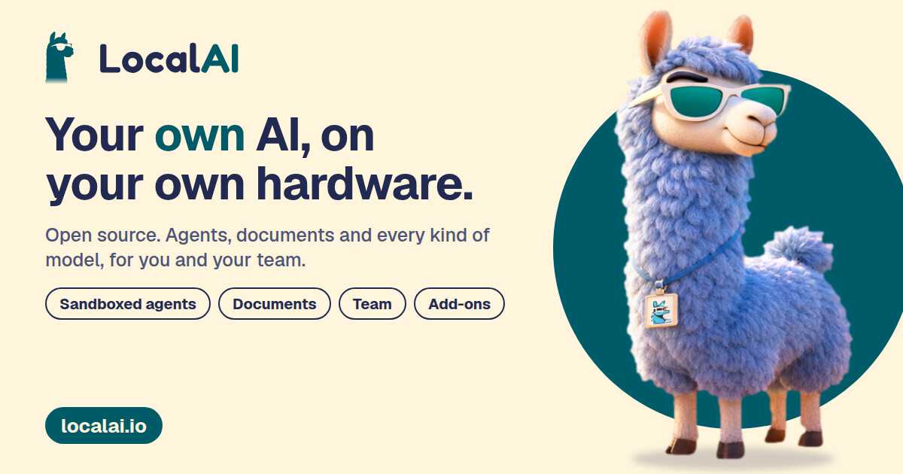
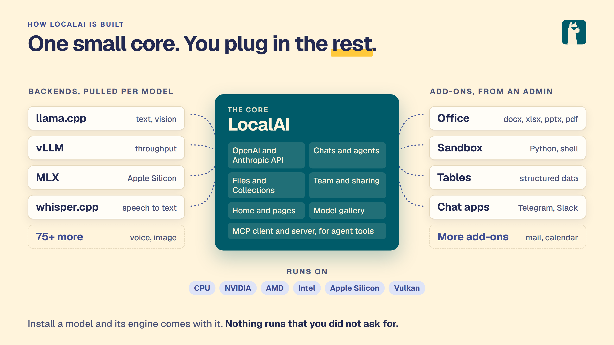

<p align="center">
  
</p>

<p align="center">
<a href="https://github.com/mudler/LocalAI/releases"></a>
<a href="LICENSE"></a>
<a href="https://discord.gg/uJAeKSAGDy"></a>
</p>

<p align="center">
<a href="https://localai.io/">Documentation</a> |
<a href="#quick-start">Quick start</a> |
<a href="https://models.localai.io/">Models</a> |
<a href="https://discord.gg/uJAeKSAGDy">Discord</a> |
<a href="https://localai.io/faq/">FAQ</a> |
<a href="https://localai.io/blog/">Blog</a>
</p>

**LocalAI** is the open-source AI engine. Run open models on your own hardware: LLMs, vision, voice, image and video. No GPU required.

- **One API**: routes in the OpenAI, Anthropic and ElevenLabs formats, for the backends that support each feature.
- **A small core, not a bundle**: each backend wraps an engine (llama.cpp, vLLM, whisper.cpp, stable-diffusion, MLX...) in its own image, pulled only when a model needs it.
- **Your hardware**: NVIDIA, AMD, Intel, Apple Silicon, Vulkan, NVIDIA Jetson or CPU-only.
- **Self-hosted**: the server, the models and your files run on your own machines.



Created by [Ettore Di Giacinto](https://github.com/mudler) and maintained by the [LocalAI team](#team).

## Quick start

On macOS, download the app: [LocalAI.dmg](https://github.com/mudler/LocalAI/releases/latest/download/LocalAI.dmg). The DMG is not signed by Apple, see [#6268](https://github.com/mudler/LocalAI/issues/6268).

With a container (Docker, podman, ...):

```bash
docker run -ti --name local-ai -p 8080:8080 localai/localai:latest
```

Then open `http://localhost:8080`. To restart an existing container, use `docker start -i local-ai`.

<details>
<summary>GPU images (NVIDIA, AMD, Intel, Vulkan)</summary>

```bash
# NVIDIA, CUDA 13
docker run -ti --name local-ai -p 8080:8080 --gpus all localai/localai:latest-gpu-nvidia-cuda-13

# NVIDIA, CUDA 12
docker run -ti --name local-ai -p 8080:8080 --gpus all localai/localai:latest-gpu-nvidia-cuda-12

# NVIDIA Jetson ARM64 (CUDA 12, for AGX Orin and similar)
docker run -ti --name local-ai -p 8080:8080 --gpus all localai/localai:latest-nvidia-l4t-arm64

# NVIDIA Jetson ARM64 (CUDA 13, for DGX Spark)
docker run -ti --name local-ai -p 8080:8080 --gpus all localai/localai:latest-nvidia-l4t-arm64-cuda-13

# AMD (ROCm)
docker run -ti --name local-ai -p 8080:8080 --device=/dev/kfd --device=/dev/dri --group-add=video localai/localai:latest-gpu-hipblas

# Intel (oneAPI)
docker run -ti --name local-ai -p 8080:8080 --device=/dev/dri/card1 --device=/dev/dri/renderD128 localai/localai:latest-gpu-intel

# Vulkan
docker run -ti --name local-ai -p 8080:8080 localai/localai:latest-gpu-vulkan
```

LocalAI detects your GPU and downloads the matching backend. See [GPU Acceleration](https://localai.io/features/gpu-acceleration/).

</details>

Load a model:

```bash
# From the model gallery (list it with `local-ai models list` or at https://models.localai.io)
local-ai run llama-3.2-1b-instruct:q4_k_m
# From Hugging Face
local-ai run huggingface://TheBloke/phi-2-GGUF/phi-2.Q8_0.gguf
# From the Ollama OCI registry
local-ai run ollama://gemma:2b
# From a standard OCI registry (for example Docker Hub)
local-ai run oci://localai/phi-2:latest
```

To talk to a running server from the terminal, start the built-in agent in another shell. It asks you to approve anything that changes state. See the [Terminal agent](https://localai.io/docs/features/terminal-agent/) docs.

```bash
local-ai chat --model llama-3.2-1b-instruct:q4_k_m
```

More in the [Getting Started guide](https://localai.io/basics/getting_started/).

## What you can do

| Area | What it gives you |
|---|---|
| [Text generation](https://localai.io/features/text-generation/) | `llama.cpp`, `transformers`, `vllm` ... [and more](https://localai.io/model-compatibility/), with an [OpenAI-compatible tools API](https://localai.io/features/openai-functions/) and [constrained grammars](https://localai.io/features/constrained_grammars/) |
| Speech | [Text to audio](https://localai.io/features/text-to-audio/), [audio to text](https://localai.io/features/audio-to-text/), voice activity detection (Silero-VAD) and the [Realtime API](https://localai.io/features/openai-realtime/) for speech-to-speech |
| Images and vision | [Image generation](https://localai.io/features/image-generation), the [Vision API](https://localai.io/features/gpt-vision/) and [object detection](https://localai.io/features/object-detection/) |
| Search | [Embeddings](https://localai.io/features/embeddings/) and a [reranker](https://localai.io/features/reranker/) |
| [Chats](https://localai.io/features/chats/) | Conversations the server keeps, with saved agents that use tools, [MCP](https://localai.io/docs/features/mcp/), skills and files, triggers, and a Telegram connector |
| Add-ons | Studio, Talk, Voice, Face, Simple Office, Sandbox and more install from a catalog and run beside the server |
| Operations | API key auth, user quotas and roles, [distributed mode](https://localai.io/features/distributed-mode/) (PostgreSQL + NATS) and [P2P inferencing](https://localai.io/features/distribute/) |
| Models and backends | [Models from Hugging Face](https://localai.io/models/) and a [Backend Gallery](https://localai.io/backends/) to install or remove backends on the fly, plus the integrated web UI |

LocalAI has more than 60 backends. Hardware acceleration covers NVIDIA (CUDA 12 and 13), AMD (ROCm), Intel (oneAPI/SYCL), Apple Silicon (Metal), Vulkan and NVIDIA Jetson (L4T). See the [Backend and Model Compatibility Table](https://localai.io/model-compatibility/).

## Latest news

- **October 2026**: **LocalAI 4.11.0** — Audio scenes with transcription, speaker labels, and sound detection. Also the Decisions API (`/v1/systemone`), model failover chains, signed OCI galleries, and Kimodo text-to-animation. [Release notes](https://github.com/mudler/LocalAI/releases/tag/v4.11.0)
- **September 2026**: **LocalAI 4.10.0** — A fleet operations dashboard, one credentials file for private model sources, and `local-ai benchmark` for measuring model latency and throughput. [Release notes](https://github.com/mudler/LocalAI/releases/tag/v4.10.0)
- **August 2026**: **LocalAI 4.9.0** — Deny-by-default authentication, opt-in chat context compression, unified model and backend management, and MiniMax-H3 video generation with audio. [Release notes](https://github.com/mudler/LocalAI/releases/tag/v4.9.0)

Older news and the full release notes: [GitHub Releases](https://github.com/mudler/LocalAI/releases) and the [blog](https://localai.io/blog/).

## Resources

- [Documentation](https://localai.io/) and the [Getting Started guide](https://localai.io/basics/getting_started/)
- [LLM fine-tuning guide](https://localai.io/docs/advanced/fine-tuning/), [build from source](https://localai.io/basics/build/) and [Kubernetes installation](https://localai.io/basics/getting_started/#run-localai-in-kubernetes)
- [Integrations and community projects](https://localai.io/docs/integrations/)
- [Installation video walkthrough](https://www.youtube.com/watch?v=cMVNnlqwfw4)
- [Examples](https://github.com/mudler/LocalAI-examples), including the [realtime voice assistant demo](https://github.com/localai-org/localai-realtime-demo)
- [Contributing](CONTRIBUTING.md) and [security policy](SECURITY.md)

<details>
<summary>Guided tour (videos)</summary>

https://github.com/user-attachments/assets/08cbb692-57da-48f7-963d-2e7b43883c18

<details>

<summary>
Click to see more!
</summary>

#### User and auth

https://github.com/user-attachments/assets/228fa9ad-81a3-4d43-bfb9-31557e14a36c

#### Usage metrics per user

https://github.com/user-attachments/assets/cbb03379-23b4-4e3d-bd26-d152f057007f

#### Fine-tuning and Quantization

https://github.com/user-attachments/assets/5ba4ace9-d3df-4795-b7d4-b0b404ea71ee

#### WebRTC

https://github.com/user-attachments/assets/ed88e34c-fed3-4b83-8a67-4716a9feeb7b

</details>

</details>

<details>
<summary>Backends built by us</summary>

Most backends wrap a best-in-class upstream engine. A handful of them are native C/C++/GGML engines (no Python at inference) developed and maintained by the LocalAI project itself:

| Backend | What it does |
|---------|-------------|
| [vllm.cpp](https://github.com/mudler/vllm.cpp) | From-scratch C++20 port of vLLM for text generation: paged KV cache, continuous batching, prefix caching, safetensors + GGUF loading, engine-enforced structured output, on CPU, CUDA, Metal and Vulkan. Also serves MiniMax-H3 joint video+audio generation |
| [parakeet.cpp](https://github.com/mudler/parakeet.cpp) | C++/GGML port of NVIDIA NeMo Parakeet ASR (tdt/ctc/rnnt/hybrid), with cache-aware streaming transcription |
| [moss-transcribe.cpp](https://github.com/localai-org/moss-transcribe.cpp) | C++/GGML port of OpenMOSS MOSS-Transcribe-Diarize: joint long-form transcription, speaker diarization and timestamping in a single pass |
| [moss-tts.cpp](https://github.com/mudler/moss-tts.cpp) | C++/GGML port of the OpenMOSS MOSS-TTS family: text-to-speech (MOSS-TTS-Local v1.5, 48 kHz stereo) with reference-audio voice cloning, through the MOSS-Audio-Tokenizer neural codec |
| [magpie-tts.cpp](https://github.com/mudler/magpie-tts.cpp) | C++/GGML port of NVIDIA's Magpie TTS Multilingual 357M: 22.05 kHz mono text-to-speech in 5 voices and 9+ languages, with the NanoCodec neural codec and tokenizer/G2P embedded in a single GGUF |
| [ced.cpp](https://github.com/localai-org/ced.cpp) | C++/GGML port of the CED audio-tagging models: sound-event classification (527-class AudioSet) over REST and the realtime API for live recognition |
| [voice-detect.cpp](https://github.com/localai-org/voice-detect.cpp) | Speaker recognition and voice analysis (ECAPA-TDNN, WeSpeaker, ERes2Net, CAM++, wav2vec2 age/gender/emotion), replacing the Python speaker-recognition backend |
| [voxtral-tts.c](https://github.com/mudler/voxtral-tts.c) | Mistral Voxtral-4B-TTS text-to-speech in pure C: 20 preset voices across 9 languages, 24 kHz WAV output, no dependencies beyond libc |
| [vibevoice.cpp](https://github.com/mudler/vibevoice.cpp) | Native port of Microsoft VibeVoice for TTS (voice cloning) and long-form ASR with speaker diarization |
| [rf-detr.cpp](https://github.com/localai-org/rf-detr.cpp) | Native RF-DETR object detection and instance segmentation |
| [locate-anything.cpp](https://github.com/mudler/locate-anything.cpp) | Open-vocabulary object detection and visual grounding (LocateAnything-3B) |
| [depth-anything.cpp](https://github.com/mudler/depth-anything.cpp) | Depth Anything 3 monocular metric depth + camera pose estimation |
| [face-detect.cpp](https://github.com/mudler/face-detect.cpp) | Face detection, recognition, demographics and anti-spoofing (SCRFD/ArcFace, YuNet/SFace), replacing the Python insightface backend |
| [timestral.cpp](https://github.com/mudler/timestral.cpp) | Mistral Timestral time-series forecasting: quantile forecasts with covariates, on the CPU |
| [free-splatter.cpp](https://github.com/localai-org/free-splatter.cpp) | Pose-free 3D reconstruction (FreeSplatter): turns a handful of plain photos into 3D Gaussians, no camera poses or GPU required |
| [trellis2.cpp](https://github.com/localai-org/trellis2cpp) | C++/GGML port of Microsoft TRELLIS.2: single-image to textured 3D mesh (GLB with PBR materials) |
| [gem-x.cpp](https://github.com/localai-org/gem-x.cpp) | Live human motion capture with SOMA and SMPL pose streams (CPU/Vulkan) |
| [kimodo.cpp](https://github.com/localai-org/kimodo.cpp) | C++/GGML text-to-motion on CPU and Vulkan, exported as animated skeleton GLB |
| [privacy-filter.cpp](https://github.com/localai-org/privacy-filter.cpp) | Standalone GGML PII/NER token-classification engine powering LocalAI's PII redaction tier |
| [LocalVQE](https://github.com/localai-org/LocalVQE) | Joint acoustic echo cancellation, noise suppression, and dereverberation |
| [local-store](https://github.com/mudler/LocalAI) | Local-first vector database for embeddings (shipped in-tree) |

We also maintain [apex-quant](https://github.com/localai-org/apex-quant), a per-tensor, per-layer quantization recipe for Mixture-of-Experts models that exploits their structural sparsity to produce GGUFs matching or beating Q8_0 quality - and they run out of the box on stock llama.cpp.

</details>

## Team

LocalAI is maintained by a small team of humans, together with the wider community of contributors.

- **[Ettore Di Giacinto](https://github.com/mudler)** — original author and project lead
- **[Richard Palethorpe](https://github.com/richiejp)** — maintainer

A huge thank you to everyone who contributes code, reviews PRs, files issues, and helps users in [Discord](https://discord.gg/uJAeKSAGDy). See the full [contributors list](https://github.com/mudler/LocalAI/graphs/contributors).

## Sponsors

Support the project by becoming [a backer or sponsor](https://github.com/sponsors/mudler). A huge thank you to our sponsors, who cover CI expenses, and to the individual sponsors listed on [GitHub](https://github.com/sponsors/mudler) and [buymeacoffee](https://buymeacoffee.com/mudler). Special shout out to [drikster80](https://github.com/drikster80).

<p align="center">
  <a href="https://www.spectrocloud.com/" target="blank">
    
  </a>
  <a href="https://solstone.app/" target="blank" >
    
  </a>
</p>

## License

MIT. LocalAI is created by [Ettore Di Giacinto](https://github.com/mudler/) and maintained by the [LocalAI team](#team). The LocalAI name, logo and mascot art are not covered by the MIT license: all rights reserved. See [BRAND-USAGE.md](BRAND-USAGE.md) for what you may do with them.

<details>
<summary>Citation and acknowledgements</summary>

```
@misc{localai,
  author = {Ettore Di Giacinto},
  title = {LocalAI: the open source AI engine},
  year = {2026},
  publisher = {GitHub},
  journal = {GitHub repository},
  howpublished = {\url{https://github.com/mudler/LocalAI}},
}
```

LocalAI couldn't have been built without the help of great software already available from the community: [llama.cpp](https://github.com/ggerganov/llama.cpp), [stanford_alpaca](https://github.com/tatsu-lab/stanford_alpaca), [llama-go](https://github.com/cornelk/llama-go), [alpaca.cpp](https://github.com/antimatter15/alpaca.cpp), [Stable-Diffusion-NCNN](https://github.com/EdVince/Stable-Diffusion-NCNN), [whisper.cpp](https://github.com/ggerganov/whisper.cpp), [piper](https://github.com/rhasspy/piper) and [exo](https://github.com/exo-explore/exo) (MLX distributed auto-parallel sharding).

</details>

<a href="https://github.com/mudler/LocalAI/graphs/contributors">
  
</a>
